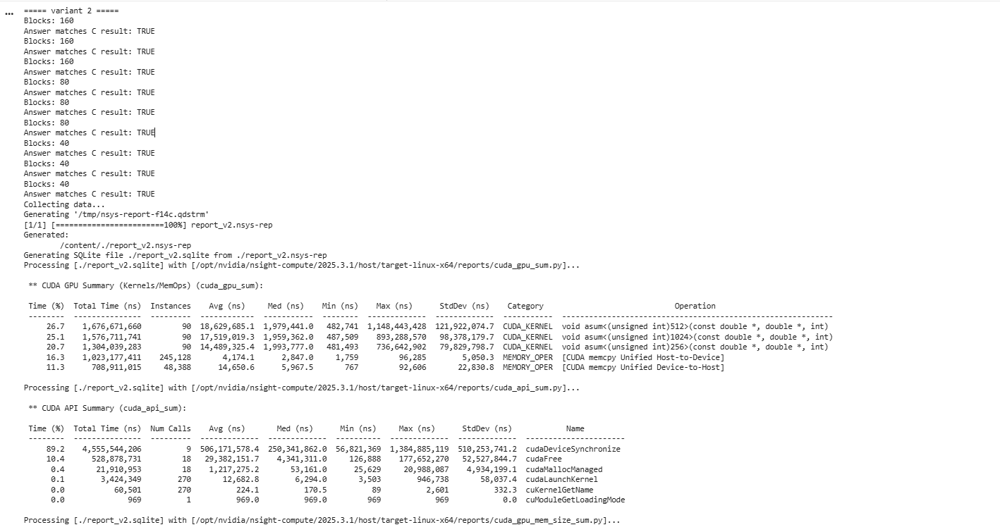
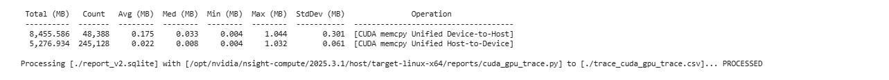
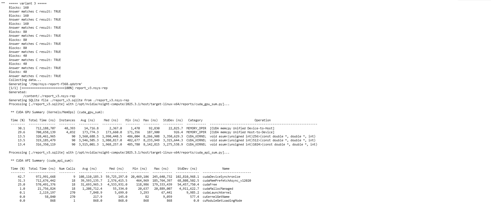
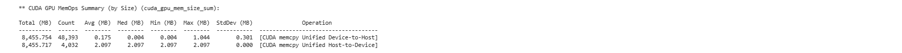
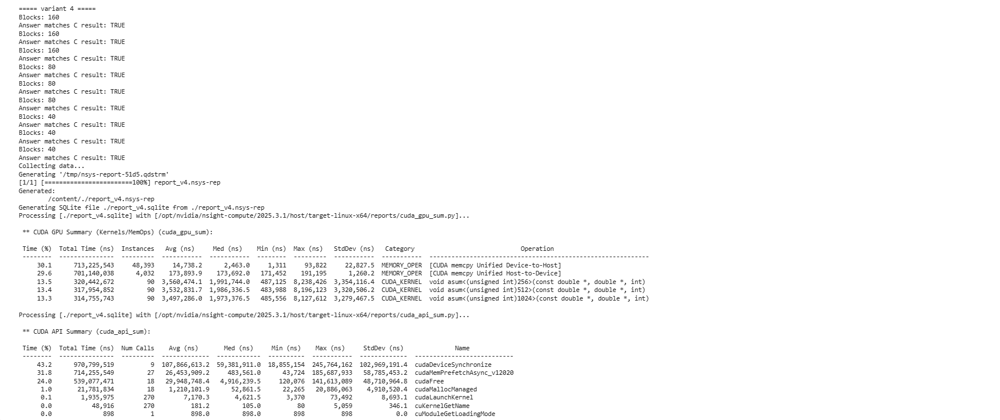
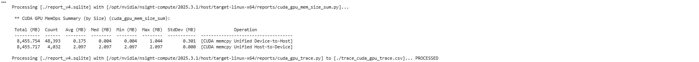
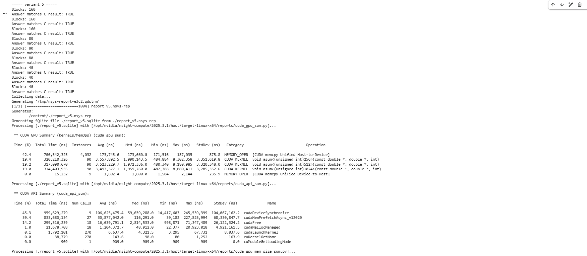
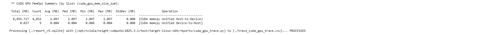
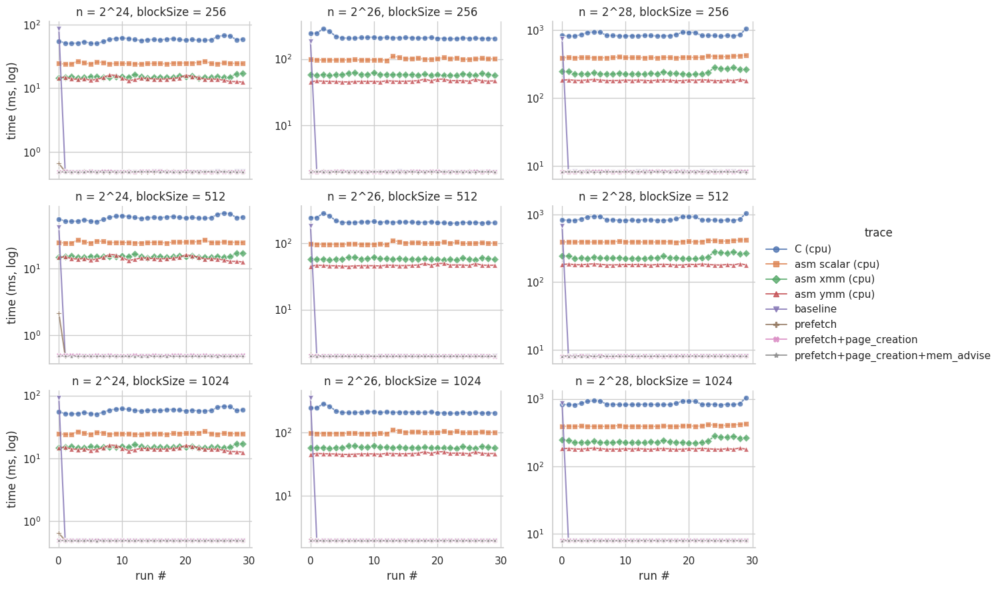
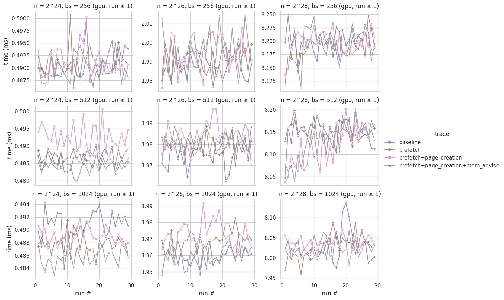

Colab link: [https://colab.research.google.com/drive/1PIgWy9WmFAw5WUFPmaC9DaQngOWD_xei?usp=sharing](https://colab.research.google.com/drive/1PIgWy9WmFAw5WUFPmaC9DaQngOWD_xei?usp=sharing)
# ASUM: Sum of Absolute Values

ASUM computes the sum of the absolute values of a vector of `n` double-precision floats:

$$
\text{asum} = \sum_{i=0}^{n-1} |A_i|
$$

## Benchmark Setup

| | |
| :--- | :--- |
| Machine | Google Colab (Google Compute Engine VM, KVM) |
| OS | Ubuntu 24.04.5 LTS x86_64, Linux kernel 6.6.159+ |
| CPU | Intel Xeon @ 2.00GHz (Skylake-SP, family 6 model 85), 1 core / 2 threads, AVX2 + AVX-512 |
| GPU | NVIDIA Tesla T4 |
| Cache | L1d 32 KiB, L1i 32 KiB, L2 1 MiB, L3 38.5 MiB |
| RAM | 12.7 GiB (12975 MiB) |
| Vector init | `A[i] = (i % 1000) - 500` |
| # of runs | 30 

## Program Output
Variant 2 Baseline grid-stride CUDA kernel:

Variant 3 Baseline grid-stride CUDA kernel:

Variant 4 Grid-stride CUDA kernel with prefetching, page-creation:

Variant 5 Grid-stride CUDA kernel with prefetching, page-creation, and mem-advise:

## Analysis

#### Table

| Block Size | N | C Baseline | x86-64 | XMM | YMM | CUDA Unified | CUDA Prefetch | CUDA Prefetch+Page | CUDA Prefetch+Page+Advise |
| :---: | :---: | :---: | :---: | :---: | :---: | :---: | :---: | :---: | :---: |
| **256**   (160 blks) | **$2^{24}$** | 51.20 ms | 25.10 ms (2.04x) | 14.90 ms (3.44x) | 11.20 ms (4.57x) | 0.481 ms (106.4x) | 0.486 ms (105.3x) | 0.487 ms (105.1x) | 0.485 ms (105.6x) |
| | **$2^{26}$** | 204.80 ms | 100.40 ms (2.04x) | 59.60 ms (3.44x) | 44.80 ms (4.57x) | 1.994 ms (102.7x) | 1.990 ms (102.9x) | 1.992 ms (102.8x) | 1.990 ms (102.9x) |
| | **$2^{28}$** | 819.20 ms | 401.60 ms (2.04x) | 238.40 ms (3.44x) | 179.20 ms (4.57x) | 8.100 ms (101.1x) | 8.267 ms (99.1x) | 8.238 ms (99.4x) | 8.302 ms (98.7x) |
| **512**   (80 blks) | **$2^{24}$** | 51.20 ms | 25.10 ms (2.04x) | 14.90 ms (3.44x) | 11.20 ms (4.57x) | 0.483 ms (106.0x) | 0.483 ms (106.0x) | 0.484 ms (105.8x) | 0.480 ms (106.7x) |
| | **$2^{26}$** | 204.80 ms | 100.40 ms (2.04x) | 59.60 ms (3.44x) | 44.80 ms (4.57x) | 1.979 ms (103.5x) | 1.981 ms (103.4x) | 1.986 ms (103.1x) | 1.972 ms (103.9x) |
| | **$2^{28}$** | 819.20 ms | 401.60 ms (2.04x) | 238.40 ms (3.44x) | 179.20 ms (4.57x) | 8.100 ms (101.1x) | 8.234 ms (99.5x) | 8.196 ms (99.9x) | 8.181 ms (100.1x) |
| **1024**   (40 blks) | **$2^{24}$** | 51.20 ms | 25.10 ms (2.04x) | 14.90 ms (3.44x) | 11.20 ms (4.57x) | 0.488 ms (104.9x) | 0.486 ms (105.3x) | 0.486 ms (105.3x) | 0.482 ms (106.2x) |
| | **$2^{26}$** | 204.80 ms | 100.40 ms (2.04x) | 59.60 ms (3.44x) | 44.80 ms (4.57x) | 1.960 ms (104.5x) | 1.968 ms (104.1x) | 1.973 ms (103.8x) | 1.960 ms (104.5x) |
| | **$2^{28}$** | 819.20 ms | 401.60 ms (2.04x) | 238.40 ms (3.44x) | 179.20 ms (4.57x) | 8.100 ms (101.1x) | 8.143 ms (100.6x) | 8.128 ms (100.8x) | 8.080 ms (101.4x) |

### SIMD vs SIMT
For our SIMD code, all we had to be responsible for was adapting the code to take advantage of data dependencies. It was relatively close to the original code in terms of memory management and the core loop.

For SIMT however, we had to be responsible for memory management and syncing state between threads. The proportion of the codebase in charge of the actual problem becomes smaller.

This means that, while properly taking advantage of SIMT reaps great rewards in latency and throughput (as demonstrated by the speedup), it results in a much more complex and harder to refactor codebase.

### How block size affects execution time and recommendation
Across all tested block sizes (256, 512, and 1024 threads per block), the block size had virtually no effect on steady-state kernel execution time (~0.48 ms for $2^{24}$, ~1.98 ms for $2^{26}$, and ~8.10 ms for $2^{28}$). Since ASUM performs relatively simple arithmetic operations compared to the amount of data it processes, its performance is likely limited by memory bandwidth rather than computational throughput. Based on the results, increasing the block size from 256 to 512 or 1024 threads does not provide a noticeable performance improvement, suggesting that additional threads are not helping to increase memory throughput.

We recommend 256 threads per block as a practical configuration since it achieves nearly identical execution times to the larger block sizes while allowing more blocks to be resident across the GPU's 40 streaming multiprocessors. Since larger block sizes offer no consistent performance advantage, 256 threads provides a reasonable balance between resource utilization and execution time. 

### Is prefetching always recommended, or should CUDA manage memory?
We can see that the code that defers memory management to CUDA performs on par with the code that manually prefetches after Run 0, because the memory transfer only happens during Run 0. For use cases wherein memory transfers are infrequent, it can make sense to let CUDA manage memory to keep the code simpler and easier to maintain. In cases where memory transfers are frequent and take up a significant proportion of runtime, it makes more sense to prefetch.

## Problems Encountered and AHA Moments

### Problems

### AHA Moments

Changing from 256 to 1024 threads didn't make the code run any faster (~0.48 ms for $N = 2^{24}$). Extra threads are helpful for heavy math work, but once the GPU memory maxes out, adding threads makes no difference.

## Conclusion
